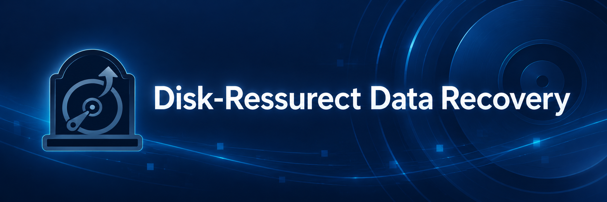

# disk-ressurect



A NTFS data recovery and forensic engine written in pure Python. This software is designed to recover files from formatted, corrupted, or partially overwritten disks using raw disk access and Master File Table (MFT) reconstruction.

## Features

Unlike basic file carvers that recover files without names, this engine reconstructs the original directory tree whenever possible.

* Virtual File System (VFS): Reads the $MFT and mounts the original folder structure in memory before extraction.
* Ghost MFT Carving: The orphan-record carver remains available as a later catalog enhancement; the desktop workflow builds the catalog from the selected volume's MFT fragments.
* Smart Header Validation: Reads physical file signatures (magic numbers) during extraction to skip corrupted or overwritten files.
* Lost-partition discovery: Searches physical media for validated NTFS structures when the partition table is missing.
* User-controlled selection: The recovery catalog exposes the original folder tree, and users choose both folders and supported file types. No folder names are excluded by default.

## Architecture

The Python backend is organized as feature modules over a small set of low-level NTFS and disk primitives:

```text
backend/src/
├── modules/
│   ├── commands/       # RecoveryCommandHandler, command DTOs and session state
│   ├── disk_discovery/ # Disk discovery service, DTOs, models, ports and repository contract
│   ├── catalog/        # Catalog service, DTOs and catalog snapshot model
│   └── recovery/       # Recovery service, planner, extractor, DTOs and result models
├── infrastructure/
│   └── persistence/    # JSON deep-scan repository implementation
├── disk/
│   ├── access/         # Raw physical-disk reads
│   ├── enumeration/    # Windows and Linux disk inventory
│   ├── partition_table/# MBR, EBR and GPT parsing
│   ├── ntfs_discovery/ # NTFS volume scanning and MFT-anchor resolution
│   ├── scanning/       # Chunk sources, signatures and MFT-anchor scanning
│   ├── deep_scan/      # Lost-partition search and future orphan-MFT recovery
│   ├── safety/         # Keep recovery output off the source disk
│   ├── models.py       # PhysicalDisk, PartitionEntry and NTFSVolume
│   └── inventory.py    # DiskInventory composition facade
├── ntfs/               # MFT parsing, VFS construction and extraction collaborators
├── domain/              # Framework-independent recovery rules
└── backend_orchestrator.py # Composition root and JSON-lines process adapter
```

Each feature module owns its use-case service and the contracts/models specific to that feature. `RecoveryCommandHandler` maps validated command DTOs to those services and returns stable response DTOs. Repository interfaces are used for persistence; physical sector access is represented by replaceable disk-reader ports, not by a CRUD repository abstraction. The entry point only composes production dependencies and adapts JSON lines to commands.

The low-level modules are deliberately separate from the feature slices: `disk/` enumerates physical disks on Windows and Linux, parses MBR/GPT, discovers NTFS partitions and reads raw sectors; `domain/` owns catalog eligibility and hierarchical selection; and `ntfs/` parses MFT records and builds the virtual tree. The recovery module composes the NTFS content reader, signature validator and output writer. Orphaned MFT record discovery remains available for a future catalog enhancement.

* frontend/src/ (React client): Contains typed domain contracts, services, hooks, reusable styled-components and page composition.
* frontend/electron/ (Desktop shell): Owns Electron main/preload processes and the context-isolated IPC contract.
* `DiskInventory` composes discovery components. Deep scan searches a bounded disk prefix for a validated `$MFT` record zero before falling back to NTFS boot-sector scanning.

Frontend pages and components each live in a folder named after the unit. Keep the React entry point in `index.tsx` and its styled-components definitions in a separate `style.ts` file in the same folder.

## Recovery catalog and selection

`TreeBuilder` creates the in-memory folder/file catalog and keeps parent/child links on each `FileNode`. `RecoveryCatalog` applies file type and minimum-size rules, while the React client lazily loads folder children and sends hierarchical selections to the Python adapter. `CatalogService` builds the catalog and `RecoveryWorkflow` extracts selected files; JSON-line progress events keep the interface responsive while disk operations run in the Python child process.

The output directory is checked against the source physical disk before recovery starts. Extraction results carry a status and reason per file. Incomplete disk reads and MFT data extents are not counted as successful recoveries.

## Prerequisites

* Windows or Linux for physical-disk discovery and raw reads.
* Python 3.10 or higher.
* Administrator/root authorization for raw physical-disk reads. On Linux, a PolicyKit authentication agent and `pkexec` are used to authorize only the Python recovery service.
* Node.js/npm for the Electron, React and TypeScript interface.
The NTFS recovery pipeline is shared across platforms. Linux support currently uses sysfs for disk inventory and read-only positional I/O on `/dev` block devices. Linux packaging and validation on physical Linux systems are still required before a distributable release.

## Electron development UI

The Electron app keeps the recovery engine in Python and starts `backend/src/backend_orchestrator.py` as a local child process. You do not start a separate Python server. From the `frontend` directory, install the dependencies and launch the development UI:

```powershell
npm install
npm run dev
```

`npm run dev` starts the Vite development server and Electron. Electron's main process launches the Python adapter automatically, using the repository virtual environment when available or the platform Python executable otherwise. Set `DISK_RESURRECT_PYTHON` to override that executable. On Windows, the app can request UAC elevation. On Linux, it can request PolicyKit authorization for the Python service through `pkexec`; the Electron UI remains at the user's normal privilege level. Source disks are opened read-only; recovered files are written only to the chosen destination. If authorization is declined, physical-disk operations stay unavailable. This development build is not yet a distributable installer; packaging must bundle the Python runtime and recovery modules with Electron for each target platform.

## How to Use

Users select a physical source disk, discover its NTFS partitions, choose an output folder and supported file types, then select folders or individual files. MBR (including logical partitions) and GPT partition tables are supported. If no partition is listed, **Deep scan lost partitions** first searches up to 8 GiB from the disk start for a validated `$MFT` root record. When it can derive a consistent partition start and runlist from that record, it offers a candidate whose end is estimated at the physical disk end; the boot sector and partition-table entry may have been overwritten. If this quick path finds no usable anchor, the scanner falls back to a full read-only search for NTFS primary/backup boot sectors. That fallback may take hours on large or slow disks.

Validated candidates found during deep scans are checkpointed to `deep_scan_cache.json` under Electron's per-user `userData` directory. Cache entries are keyed by disk model, capacity and serial number (or disk number when no serial is available), so candidates are restored only for the matching source disk. A scan interruption keeps already discovered candidates; completed scans replace the old candidate set. Selecting the same disk after reopening the app restores those candidates without rerunning the scan.

Keep the output destination on a different physical disk from the source. A lost partition cannot be reconstructed if its NTFS boot sectors and MFT metadata have both been overwritten. This is a test build: validate on disposable images or duplicate media before relying on it for important recovery work.

## Tests

Run the Python unit suite without accessing a physical disk (discovery uses synthetic media) and the React tests:

```powershell
.\venv\Scripts\python.exe -m unittest discover -s backend\src\tests -v
Push-Location frontend
npm test
Pop-Location
```
